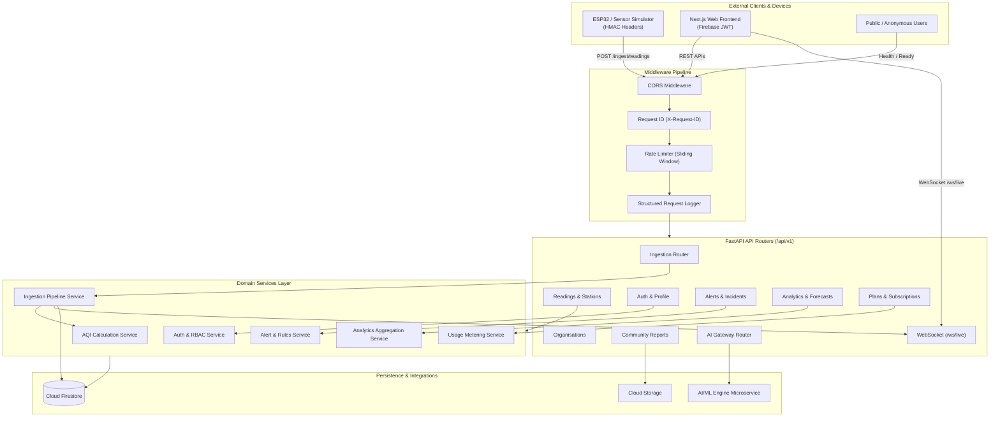

# STREETAIR — AI-Powered Environmental Intelligence SaaS Backend

[](https://www.python.org/)
[](https://fastapi.tiangolo.com/)
[](https://firebase.google.com/docs/firestore)
[](https://docs.pytest.org/)
[](LICENSE)

The enterprise-grade central integration backend for **STREETAIR**: an AI-powered environmental monitoring and pollution intelligence SaaS platform. The system connects physical IoT monitoring stations (ESP32 hardware), citizen incident reports, real-time analytics engines, AI inference microservices, and client visualization dashboards.

---

## Table of Contents

1. [Project Overview](#1-project-overview)
2. [Backend Features](#2-backend-features)
3. [Technology Stack](#3-technology-stack)
4. [Backend Architecture](#4-backend-architecture)
5. [Folder Structure](#5-folder-structure)
6. [Prerequisites](#6-prerequisites)
7. [Installation and Setup](#7-installation-and-setup)
8. [Environment Variables](#8-environment-variables)
9. [Database Configuration](#9-database-configuration)
10. [How to Run the Backend](#10-how-to-run-the-backend)
11. [API Documentation](#11-api-documentation)
12. [API Endpoints](#12-api-endpoints)
13. [Authentication and Security](#13-authentication-and-security)
14. [External API and Service Integrations](#14-external-api-and-service-integrations)
15. [Testing Instructions](#15-testing-instructions)
16. [Test Results Summary](#16-test-results-summary)
17. [Common Errors and Troubleshooting](#17-common-errors-and-troubleshooting)

---

## 1. Project Overview

**STREETAIR** provides continuous air quality surveillance, early warning detection, predictive forecasting, and incident response management for citizens, smart municipalities, industrial plants, and environmental agencies.

- **Primary Demonstration Site**: B.S. Abdur Rahman Crescent Institute of Science and Technology, Vandalur, Tamil Nadu, India (`12.8797° N, 80.0805° E`).
- **Core Workflow**: `MONITOR` → `DETECT` → `INVESTIGATE` → `ANALYSE` → `PREDICT` → `RESPOND`.
- **9 Environmental Demonstration Scenarios**:
  1. `normal`: Clean baseline ambient conditions.
  2. `traffic_congestion`: Elevated $PM_{2.5}$, $PM_{10}$, and $NO_2$ combustion spikes during peak hours.
  3. `construction_dust`: High coarse particulate matter ($PM_{10}$) with moderate $PM_{2.5}$.
  4. `industrial_emissions`: Heavy volatile organic compounds ($VOC$), $SO_2$, and particulate release.
  5. `waste_burning`: Extreme $CO$, fine particulates ($PM_{2.5}$), and combustion gases.
  6. `high_humidity`: Elevated atmospheric moisture and foggy inversion conditions.
  7. `smoke_event`: Dense smoke plume with high opacity and particulate counts.
  8. `pollution_dispersal`: Rapid drop in pollutant concentrations due to thermal/wind dissipation.
  9. `extreme_pollution`: Hazardous multi-pollutant threshold breach exceeding regulatory ceilings.

---

## 2. Backend Features

- **High-Throughput Ingestion Engine**:
  - Ingestion pipeline with strict schema validation and physical sensor boundary checks ($PM_1$, $PM_{2.5}$, $PM_{10}$, $CO$, $NO_2$, $SO_2$, $O_3$, $NH_3$, $VOC$, Temp, Humidity, Pressure).
  - Dual HMAC-SHA256 hardware token authentication with replay and timestamp skew mitigation ($\pm 300\text{s}$).
  - Cryptographic idempotency hashing (`station_id` + `timestamp` + `sensor_hash`) preventing duplicate telemetry entries.
- **CPCB 2014 AQI Calculation Engine**:
  - Full implementation of the Central Pollution Control Board (CPCB) India National Air Quality Index (NAQI) breakpoints.
  - Sub-index computation with dominant pollutant identification and categorical classification (`Good`, `Satisfactory`, `Moderate`, `Poor`, `Very Poor`, `Severe`).
- **Real-Time Distribution Engine**:
  - Native ASGI WebSocket manager supporting public broadcast streams and tenant-isolated organisation channels.
  - Heartbeat ping/pong lifecycle with automatic client cleanup.
- **Enterprise Multi-Tenancy & Access Control**:
  - Strict organisation-level data isolation.
  - Role-Based Access Control (RBAC): `viewer`, `operator`, `analyst`, `admin`, `system_admin`.
  - Automatic Firebase User Profile synchronization and claim resolution.
- **Incident & Alert Lifecycle**:
  - Automated threshold rule evaluation upon reading ingestion.
  - Configurable alert cooldown timer (default: 300s) preventing notification floods.
  - Multi-stage incident lifecycle management (`detected` → `investigating` → `mitigating` → `resolved`).
- **Crowdsourced Citizen Reporting**:
  - Citizen pollution report submissions with geolocation, pollutant indicators, and image URL attachments.
  - Administrative moderation workflow (`pending` → `verified` / `rejected`).
- **SaaS Commercial Billing & Usage Metering**:
  - Multi-tier SaaS plan matrix (`Community`, `Professional`, `Enterprise`, `Municipal`).
  - Active subscription tracking with real-time usage consumption metering (ingested readings, incident reports, AI conversational credits).
- **AI Microservice Gateway**:
  - Reverse proxy integration with internal AI Engine microservices.
  - Authenticated service token handshakes for anomaly diagnosis, air quality forecasting, and conversational RAG explanations.

---

## 3. Technology Stack

| Layer | Component | Version / Description |
| :--- | :--- | :--- |
| **Language** | Python | `3.11+` |
| **Framework** | FastAPI | `0.111.0` (Asynchronous ASGI Web Framework) |
| **Server** | Uvicorn | `0.29.0` (Lightning-fast ASGI Server) |
| **Validation** | Pydantic v2 | `2.7.1` (Strict Schema & Type Enforcement) |
| **Database** | Cloud Firestore | `firebase-admin 6.5.0` (Document NoSQL Database) |
| **Authentication** | Firebase Auth | JWT Bearer Verification & Custom Claims |
| **HTTP Client** | HTTPX | `0.27.0` (Async Internal Service Requests) |
| **Real-Time** | WebSockets | Native Starlette / FastAPI ASGI WebSockets |
| **Logging** | Structlog | `24.1.0` (Structured JSON Logging) |
| **Security** | Cryptography / Hashlib | HMAC-SHA256 Hardware Signatures & API Keys |
| **Identifiers** | ULID | `ulid-py 1.1.0` (Lexicographically sortable IDs) |
| **Testing** | Pytest & AnyIO | `pytest 8.2.0`, `pytest-asyncio 0.23.6` |

---

## 4. Backend Architecture

The backend follows Clean Layered Architecture with strict separation of concerns:



---

## 5. Folder Structure

```
backend/
├── app/
│   ├── api/
│   │   ├── v1/
│   │   │   ├── admin.py            # Administrative moderation & user overrides
│   │   │   ├── ai.py               # AI conversational gateway & assistant chat
│   │   │   ├── alerts.py           # Threshold alert acknowledgement & listing
│   │   │   ├── analytics.py        # Trend analysis, diurnal curves & hotspots
│   │   │   ├── auth.py             # User profile sync & role resolution
│   │   │   ├── devices.py          # Station management & hardware credentials
│   │   │   ├── incidents.py        # Environmental incident tracking lifecycle
│   │   │   ├── ingestion.py        # Sensor telemetry ingestion endpoint
│   │   │   ├── organisations.py    # Multi-tenant organisation workspace CRUD
│   │   │   ├── plans.py            # SaaS tier definitions
│   │   │   ├── predictions.py      # AI forecast models & historical prediction
│   │   │   ├── readings.py         # Station readings query & history
│   │   │   ├── reports.py          # Citizen community report submissions
│   │   │   ├── subscriptions.py    # Subscription management & entitlement status
│   │   │   └── usage.py            # Quota consumption & tenant usage metrics
│   │   └── router.py               # Combined API v1 master router
│   ├── core/
│   │   ├── aqi.py                  # CPCB 2014 India NAQI calculation engine
│   │   ├── config.py               # Pydantic v2 Settings from environment
│   │   ├── exceptions.py           # Domain exception classes & error mapping
│   │   ├── logging.py              # Structlog logging configuration
│   │   └── security.py             # HMAC tokens, hashing & security utilities
│   ├── integrations/
│   │   ├── ai_engine/
│   │   │   └── client.py           # Async HTTPX client for internal AI engine
│   │   ├── firebase/
│   │   │   └── __init__.py         # Firebase Admin SDK & Firestore client
│   │   └── mqtt/
│   │       └── client.py           # MQTT broker abstraction for hardware
│   ├── middleware/
│   │   ├── auth.py                 # Firebase JWT verification dependency
│   │   ├── device_auth.py          # Dual HMAC device header verification
│   │   ├── logging.py              # Per-request logging with execution latency
│   │   ├── rate_limit.py           # In-memory sliding window rate limiter
│   │   └── request_id.py           # X-Request-ID propagation middleware
│   ├── repositories/
│   │   ├── alerts.py               # Firestore repository for alerts & incidents
│   │   ├── organisations.py        # Firestore repository for orgs & members
│   │   ├── readings.py             # Firestore repository for telemetry readings
│   │   ├── reports.py              # Firestore repository for community reports
│   │   ├── stations.py             # Firestore repository for monitoring stations
│   │   └── subscriptions.py        # Firestore repository for SaaS plans & usage
│   ├── schemas/
│   │   ├── admin.py                # Schemas for admin status updates
│   │   ├── ai.py                   # Schemas for AI chat prompts & responses
│   │   ├── alerts.py               # Schemas for alerts & incident reports
│   │   ├── analytics.py            # Schemas for summary trends & scenario definitions
│   │   ├── auth.py                 # Schemas for user profiles & authentication
│   │   ├── common.py               # Common pagination & standard error envelope
│   │   ├── devices.py              # Schemas for stations & credentials
│   │   ├── organisations.py        # Schemas for organisations & memberships
│   │   ├── readings.py             # Canonical IngestPayload & ReadingResponse
│   │   ├── reports.py              # Schemas for citizen incident reports
│   │   └── subscriptions.py        # Schemas for SaaS plans, invoices & usage
│   ├── services/
│   │   ├── alert_service.py        # Threshold rule evaluation & alert dispatch
│   │   ├── ingestion_service.py    # Ingestion pipeline, validation & deduplication
│   │   └── usage_service.py        # Quota verification & usage decrement
│   ├── websocket/
│   │   ├── auth.py                 # WebSocket query param authentication
│   │   └── manager.py              # Multi-channel connection manager & broadcast
│   └── main.py                     # FastAPI application entrypoint & lifecycle
├── docs/
│   ├── AI_API_CONTRACT.md          # Internal service contract for AI microservice
│   ├── API_CONTRACT.md             # Public REST API documentation
│   ├── DATABASE_SCHEMA.md          # Cloud Firestore collection structures
│   └── HARDWARE_PROTOCOL.md        # Hardware ingestion specs for ESP32
├── scripts/
│   ├── seed_data.py                # Database seeder for demo station & plans
│   ├── simulator.py                # 9-scenario hardware sensor simulator
│   └── verify_server.py            # Standalone API verification script
├── tests/
│   ├── conftest.py                 # Pytest fixtures & in-memory Firestore mock
│   ├── integration/                # Full API endpoint integration tests
│   │   ├── test_alerts_and_admin.py
│   │   ├── test_analytics_and_predictions.py
│   │   ├── test_auth_and_orgs.py
│   │   ├── test_devices_stations.py
│   │   ├── test_ingestion_pipeline.py
│   │   ├── test_pipeline.py
│   │   ├── test_reports_and_incidents.py
│   │   └── test_subscriptions_and_plans.py
│   └── unit/                       # Core algorithm & security unit tests
│       ├── test_aqi.py
│       ├── test_schemas.py
│       ├── test_security.py
│       └── test_websocket.py
├── .env.example                    # Environment variable configuration template
├── README.md                       # Comprehensive backend documentation
└── requirements.txt                # Production & test dependencies
```

---

## 6. Prerequisites

- **Python**: Version `3.11` or higher installed.
- **Package Manager**: `pip` (Python package manager).
- **Google Cloud / Firebase Project**:
  - A Google Cloud Project with Cloud Firestore enabled in Native mode.
  - A Firebase Service Account Key JSON file (or Google Application Default Credentials via `gcloud auth application-default login`).
- **Operating System**: Linux, macOS, or Windows 10/11.

---

## 7. Installation and Setup

### Step 1: Navigate to the Backend Directory
```bash
cd backend
```

### Step 2: Create and Activate a Virtual Environment
- **On Linux / macOS**:
  ```bash
  python3 -m venv venv
  source venv/bin/activate
  ```
- **On Windows (PowerShell)**:
  ```powershell
  python -m venv venv
  .\venv\Scripts\Activate.ps1
  ```

### Step 3: Install Required Dependencies
```bash
pip install -r requirements.txt
```

### Step 4: Configure Environment Variables
Copy the template `.env.example` file to `.env`:
```bash
cp .env.example .env
```
Open `.env` in an editor and update the parameters (see [Section 8](#8-environment-variables)).

---

## 8. Environment Variables

| Variable Name | Description | Default Value | Required |
| :--- | :--- | :--- | :--- |
| `APP_ENV` | Application environment (`development`, `staging`, `production`) | `development` | Yes |
| `API_HOST` | Host address to bind the HTTP server | `0.0.0.0` | Yes |
| `API_PORT` | Port number to bind the HTTP server | `8000` | Yes |
| `API_BASE_URL` | Canonical public base URL | `http://localhost:8000` | Yes |
| `LOG_LEVEL` | Logging verbosity (`DEBUG`, `INFO`, `WARNING`, `ERROR`) | `INFO` | No |
| `DEBUG` | Enable debug traceback responses | `false` | No |
| `CORS_ORIGINS` | Comma-separated list of allowed CORS origins | `http://localhost:3000,http://localhost:3001` | Yes |
| `FIREBASE_PROJECT_ID` | GCP / Firebase project identifier | `your-firebase-project-id` | Yes |
| `FIREBASE_CREDENTIALS_PATH` | Relative or absolute path to Service Account JSON | `./firebase-service-account.json` | Local dev |
| `FIREBASE_STORAGE_BUCKET` | Google Cloud Storage bucket for report attachments | `your-firebase-project-id.appspot.com`| No |
| `AI_ENGINE_URL` | Base URL for internal AI/ML inference service | `http://localhost:8001` | Yes |
| `AI_ENGINE_SERVICE_TOKEN` | Shared secret token for AI microservice auth | `change-me-generate-a-secure-token` | Yes |
| `DEVICE_AUTH_SECRET` | HMAC secret for signing ESP32 device credentials | `change-me-generate-a-secure-32-byte-secret` | Yes |
| `RATE_LIMIT_REQUESTS_PER_MINUTE`| Maximum standard API requests per IP per minute | `60` | No |
| `RATE_LIMIT_INGEST_PER_MINUTE` | Maximum ingestion calls per device per minute | `30` | No |
| `ALERT_COOLDOWN_SECONDS` | Minimum seconds between recurring alerts per station | `300` | No |
| `DEFAULT_PAGE_SIZE` | Default number of records in paginated lists | `20` | No |
| `MAX_PAGE_SIZE` | Maximum records allowed in a single page | `100` | No |

---

## 9. Database Configuration

STREETAIR uses **Google Cloud Firestore** as its document database.

### 1. Firestore Authentication
- **Local Development**:
  Download a Firebase service account private key from the [Firebase Console](https://console.firebase.google.com/) (`Project Settings` > `Service Accounts` > `Generate new private key`). Save it as `backend/firebase-service-account.json` and set:
  ```env
  FIREBASE_CREDENTIALS_PATH=./firebase-service-account.json
  ```
- **Google Cloud Run / Production**:
  Omit `FIREBASE_CREDENTIALS_PATH`. Cloud Run automatically uses Application Default Credentials (ADC) attached to the runtime service account.
- **Offline Mock Mode**:
  If no credentials file is provided in `development` mode, the backend starts in graceful offline fallback mode. The unit and integration test suite automatically uses an isolated in-memory test double (`MockFirestoreClient`).

### 2. Firestore Collections Schema
The backend persists data across the following canonical collections:
- `users`: User profiles, role assignments, organisation associations.
- `organisations`: Multi-tenant workspace entities, domains, subscription references.
- `stations`: Monitoring stations, coordinates, hardware credentials, online status.
- `readings_latest`: High-speed latest reading per station (keyed by `station_id`).
- `readings`: Append-only historical time-series telemetry records.
- `alerts`: Active and historic environmental threshold breach events.
- `incidents`: Multi-stage investigated incident records.
- `reports`: Citizen pollution reports with verification status.
- `plans`: SaaS subscription tier catalog definitions.
- `subscriptions`: Active customer subscriptions and tenant entitlements.
- `usage`: Monthly metered resource consumption tracking.

### 3. Recommended Composite Indexes
Deploy the following composite indexes in Firestore for optimal query performance:
```json
{
  "indexes": [
    {
      "collectionGroup": "readings",
      "queryScope": "COLLECTION",
      "fields": [
        { "fieldPath": "station_id", "order": "ASCENDING" },
        { "fieldPath": "timestamp", "order": "DESCENDING" }
      ]
    },
    {
      "collectionGroup": "alerts",
      "queryScope": "COLLECTION",
      "fields": [
        { "fieldPath": "station_id", "order": "ASCENDING" },
        { "fieldPath": "created_at", "order": "DESCENDING" }
      ]
    },
    {
      "collectionGroup": "reports",
      "queryScope": "COLLECTION",
      "fields": [
        { "fieldPath": "status", "order": "ASCENDING" },
        { "fieldPath": "created_at", "order": "DESCENDING" }
      ]
    }
  ]
}
```

---

## 10. How to Run the Backend

### 1. Seeding Demo Data
To register the B.S. Abdur Rahman Crescent Institute demonstration station (`crescent-station-01`), seed standard SaaS tiers, and populate initial records:
```bash
python scripts/seed_data.py
```

### 2. Running in Development Mode
Start the FastAPI server with auto-reload:
```bash
uvicorn app.main:app --host 0.0.0.0 --port 8000 --reload
```

### 3. Running in Production Mode
Start with production ASGI workers:
```bash
uvicorn app.main:app --host 0.0.0.0 --port 8000 --workers 4 --access-log
```

### 4. Running the Hardware Sensor Simulator
To simulate environmental conditions without physical hardware:
```bash
# Send a single reading for normal air quality
python scripts/simulator.py --scenario normal

# Continuously send simulated readings every 5 seconds for traffic congestion
python scripts/simulator.py --scenario traffic_congestion --interval 5 --count 0

# Test industrial emissions scenario
python scripts/simulator.py --scenario industrial_emissions --interval 3 --count 10
```

---

## 11. API Documentation

Once the server is running, interactive API documentation is automatically accessible:
- **Swagger Interactive UI**: [http://localhost:8000/docs](http://localhost:8000/docs)
- **Redoc Visual Reference**: [http://localhost:8000/redoc](http://localhost:8000/redoc)
- **OpenAPI 3.1 JSON Specification**: [http://localhost:8000/openapi.json](http://localhost:8000/openapi.json)

### Standard Error Response Envelope
All non-2xx responses adhere to the canonical error format:
```json
{
  "error_code": "RESOURCE_NOT_FOUND",
  "message": "Station crescent-station-99 was not found",
  "detail": null,
  "request_id": "01HY7ABC1234XYZ",
  "timestamp": "2026-11-04T17:30:00Z"
}
```

---

## 12. API Endpoints

### A. Health & Readiness
- `GET /health`: Liveness probe. Returns server status, environment, and current UTC time.
- `GET /ready`: Readiness probe. Validates Firestore and external integration readiness.

### B. Ingestion API
- `POST /api/v1/ingest/readings`: ESP32 & IoT telemetry ingestion.
  - **Headers**:
    - `X-Device-ID`: Unique station ID (e.g. `crescent-station-01`)
    - `X-Device-Token`: HMAC-SHA256 signature
  - **Request Body Example**:
    ```json
    {
      "station_id": "crescent-station-01",
      "timestamp": "2026-11-04T17:30:00Z",
      "sensors": {
        "pm1": 12.4,
        "pm25": 28.5,
        "pm10": 45.2,
        "co": 0.6,
        "no2": 21.0,
        "so2": 8.0,
        "temperature": 31.2,
        "humidity": 68.0,
        "pressure": 1008.2
      },
      "data_source": "simulated",
      "scenario": "normal"
    }
    ```
  - **Response (201 Created)**:
    ```json
    {
      "success": true,
      "reading_id": "01HY7XYZ999ABC",
      "station_id": "crescent-station-01",
      "timestamp": "2026-11-04T17:30:00Z",
      "aqi": 71,
      "aqi_category": "Satisfactory",
      "dominant_pollutant": "pm25",
      "alerts_triggered": []
    }
    ```

### C. Monitoring Stations & Telemetry
- `GET /api/v1/stations`: List active monitoring stations with filtering by organisation or status.
- `GET /api/v1/stations/{station_id}`: Retrieve detailed metadata for a specific station.
- `GET /api/v1/readings/latest`: Retrieve latest snapshot readings for all or specified stations.
- `GET /api/v1/readings/history?station_id=crescent-station-01&limit=50`: Query historical time-series readings with date boundaries.

### D. Identity & Organisations
- `GET /api/v1/auth/me`: Resolve authenticated user profile, permissions, and tenant memberships.
- `PUT /api/v1/auth/profile`: Update user display name and notification preferences.
- `GET /api/v1/organisations`: List organisations the authenticated user belongs to.
- `POST /api/v1/organisations`: Create a new organisation tenant workspace.
- `GET /api/v1/organisations/{org_id}/members`: List members and roles in an organisation.

### E. Alerts & Incidents
- `GET /api/v1/alerts`: Query environmental threshold alerts with status filtering (`active`, `acknowledged`, `resolved`).
- `POST /api/v1/alerts/{alert_id}/acknowledge`: Acknowledge an alert to prevent repeat notifications.
- `GET /api/v1/incidents`: Retrieve investigated pollution incidents.
- `POST /api/v1/incidents`: Escalate an alert or report into an active investigation incident.

### F. Citizen Community Reports
- `POST /api/v1/reports`: Submit crowdsourced pollution observations with coordinates and photo attachments.
- `GET /api/v1/reports`: List community reports filtered by proximity, status, or date.
- `POST /api/v1/admin/reports/{report_id}/status`: Admin endpoint to verify or reject citizen reports.

### G. Analytics & AI Predictions
- `GET /api/v1/analytics/overview`: High-level aggregate metrics, average AQI, and breach counts.
- `GET /api/v1/analytics/trends?station_id=crescent-station-01&window=24h`: Hourly moving averages and diurnal curves.
- `GET /api/v1/analytics/hotspots`: Spatial clustering of high-pollution zones.
- `GET /api/v1/analytics/scenarios`: Definition metadata for the 9 demonstration scenarios.
- `GET /api/v1/predictions?station_id=crescent-station-01`: Multi-horizon forecast values (1h, 6h, 24h).
- `POST /api/v1/ai/chat`: AI environmental assistant chat query with meter credit deduction.

### H. SaaS Subscriptions & Usage
- `GET /api/v1/plans`: Catalog of available SaaS subscription tiers.
- `GET /api/v1/subscriptions`: Current organisation subscription status and entitlements.
- `POST /api/v1/subscriptions`: Subscribe or upgrade subscription tier.
- `GET /api/v1/usage`: Real-time tenant quota consumption (readings, reports, AI tokens).

### I. Real-Time WebSocket
- `ws://localhost:8000/ws/live`: Real-time bidirectional socket.
  - Query parameters: `?token=<firebase_jwt>` (optional for public channel, required for private tenant feeds).
  - Emits: `reading_received`, `alert_triggered`, `incident_updated`.

---

## 13. Authentication and Security

1. **User Identity (Firebase Authentication)**:
   - Client requests provide standard `Authorization: Bearer <token>` headers.
   - The backend validates signature, expiration, and issuer via Firebase Admin SDK.
   - User profile and organisation roles are automatically resolved upon request.
2. **IoT Hardware Verification (Dual HMAC Headers)**:
   - Hardware transmissions require `X-Device-ID` and `X-Device-Token`.
   - The token is computed via `HMAC-SHA256(secret, device_id)`.
   - Hardware requests with invalid tokens, expired timestamps, or missing headers are rejected with HTTP 401/403.
3. **Data Isolation & Multi-Tenancy**:
   - Organisation data queries strictly enforce organisation scoping (`where organisation_id == user.organisation_id`).
   - Cross-tenant access attempts are rejected with `FORBIDDEN` exceptions.
4. **Rate Limiting & Threat Protection**:
   - Sliding-window in-memory rate limiting applied globally per IP (`60 req/min`) and per device (`30 req/min`).
   - Strict payload size limits (maximum 1MB).
   - Sensor range validation guards against malformed or negative sensor injections.

---

## 14. External API and Service Integrations

1. **Google Cloud Firestore**:
   - High-availability distributed document database for real-time reads, writes, and historical analytics.
2. **AI / ML Engine Microservice**:
   - Communicates via internal authenticated HTTP (`AI_ENGINE_URL` and `AI_ENGINE_SERVICE_TOKEN`).
   - Invokes endpoints for automated anomaly diagnosis, time-series forecasting, and conversational RAG.
3. **Google Cloud Storage**:
   - Secure bucket storage for citizen report photos and incident evidence uploads.
4. **MQTT Broker (Extensible Abstraction)**:
   - Includes standard client interfaces (`app/integrations/mqtt/client.py`) for direct broker-based ingestion when scaling beyond HTTP.

---

## 15. Testing Instructions

STREETAIR features a complete automated test suite verifying units, schemas, security algorithms, and full API integration flows.

### Running All Tests
```bash
pytest tests -v
```

### Running Specific Test Suites
```bash
# Run unit tests only (AQI engine, schemas, HMAC security, WebSockets)
pytest tests/unit -v

# Run integration tests only (pipeline, ingestion, auth, devices, analytics)
pytest tests/integration -v
```

### In-Memory Test Isolation
The test suite utilizes `tests/conftest.py` with an asynchronous test client and an isolated in-memory Firestore double (`MockFirestoreClient`). Tests run completely offline without requiring live Firebase network access or active GCP credentials.

---

## 16. Test Results Summary

All **32 automated tests** execute and pass cleanly:

| Test File | Tests | Status | Scope |
| :--- | :---: | :---: | :--- |
| `tests/unit/test_aqi.py` | 7 | **PASSED** | CPCB 2014 breakpoint ranges (`Good` to `Severe`), missing pollutant edge cases |
| `tests/unit/test_security.py` | 3 | **PASSED** | HMAC-SHA256 token signing/verification, API key hashing, Request ID format |
| `tests/unit/test_schemas.py` | 3 | **PASSED** | IngestPayload bounds validation, invalid data sources, negative value rejection |
| `tests/unit/test_websocket.py` | 1 | **PASSED** | WebSocket connection lifecycle, tenant channel isolation, broadcast delivery |
| `tests/integration/test_pipeline.py` | 4 | **PASSED** | `/health`, `/ready`, unauthorized endpoint rejection, missing device headers |
| `tests/integration/test_ingestion_pipeline.py` | 2 | **PASSED** | End-to-end sensor ingestion, deduplication hash, out-of-bounds rejection |
| `tests/integration/test_devices_stations.py` | 2 | **PASSED** | Station discovery, single station query, 404 handling |
| `tests/integration/test_auth_and_orgs.py` | 2 | **PASSED** | User profile sync (`/auth/me`), profile updates, organisation lifecycle |
| `tests/integration/test_analytics_and_predictions.py` | 2 | **PASSED** | Trends, diurnal patterns, hotspots, 9 scenario definitions, prediction query |
| `tests/integration/test_reports_and_incidents.py` | 2 | **PASSED** | Citizen report submission, incident investigation lifecycle |
| `tests/integration/test_subscriptions_and_plans.py` | 1 | **PASSED** | SaaS plan catalog, subscription upgrades, usage quota tracking |
| `tests/integration/test_alerts_and_admin.py` | 3 | **PASSED** | Threshold alerts acknowledgement, admin report moderation, AI chat interaction |
| **Total** | **32** | **100% Passing** | **Execution Time: ~4.8s** |

---

## 17. Common Errors and Troubleshooting

### 1. `Firebase initialization deferred or in mock/offline mode`
- **Cause**: No `firebase-service-account.json` found at the configured path during local development.
- **Solution**: For local development or running tests, this warning is expected and safe — the system falls back to test double / offline mode. For production, download your Firebase service account key, set `FIREBASE_CREDENTIALS_PATH=./firebase-service-account.json`, or log in via `gcloud auth application-default login`.

### 2. `HTTP 401 Unauthorized: Invalid or missing device authentication headers`
- **Cause**: An ingestion request to `/api/v1/ingest/readings` did not supply matching `X-Device-ID` and `X-Device-Token` headers.
- **Solution**: Use `scripts/simulator.py` which automatically computes valid HMAC-SHA256 signatures using `DEVICE_AUTH_SECRET`, or generate the header with `hmac.new(secret.encode(), device_id.encode(), hashlib.sha256).hexdigest()`.

### 3. `HTTP 422 Unprocessable Entity: Sensor reading out of valid bounds`
- **Cause**: A sensor metric submitted exceeded physical boundary limits (e.g. $PM_{2.5} > 1500$, negative temperatures below $-20^\circ\text{C}$, or relative humidity $> 100\%$).
- **Solution**: Verify the physical sensor calibration or adjust validation thresholds in `.env` (`PM25_MAX`, `HUMIDITY_MAX`, etc.).

### 4. `HTTP 429 Too Many Requests`
- **Cause**: Client exceeded the configured request rate limit.
- **Solution**: Wait for the 60-second sliding window to reset, or adjust `RATE_LIMIT_REQUESTS_PER_MINUTE` in your `.env` file.

### 5. Port `8000` Already In Use
- **Cause**: Another local process is occupying port 8000.
- **Solution**: Stop the conflicting process, or run Uvicorn on an alternative port:
  ```bash
  uvicorn app.main:app --host 0.0.0.0 --port 8080 --reload
  ```
